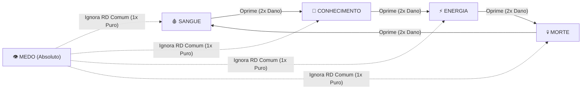
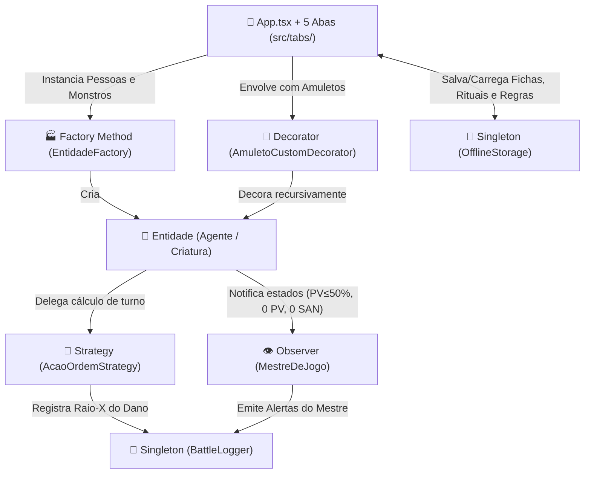

# ⚔️ Simulador Ordem Paranormal RPG (Edição Completa & 100% Offline)

**Descrição do Projeto:**
Simulador tático e configurável de combate baseado no sistema oficial **Ordem Paranormal RPG**, desenvolvido como evolução arquitetural do [`simulador_rpg`](../simulador_rpg). O projeto aplica rigorosamente **5 Padrões de Projeto GoF (Gang of Four)** — `Singleton`, `Strategy`, `Factory Method`, `Decorator` e `Observer` — resolvendo o acoplamento entre criação de múltiplos combatentes, cálculo de dados customizados (`d4` a `d100`), empilhamento dinâmico de maldições/amuletos, ciclo de opressão elemental, persistência local 100% offline e notificações automáticas de estado crítico pelo Mestre de Jogo.

O sistema conta com **duas interfaces integradas sobre o mesmo motor de domínio**:
- **📱💻 Aplicação Visual Multi-Abas (React Native + Expo Offline)**: Interface interativa estilo *Dark Paranormal* para Web, Android e iOS, funcionando sem necessidade de internet ou conta Expo.
- **🖥️ Simulador via Terminal (CLI com `tsx`)**: Execução automatizada no console demonstrando o funcionamento conjunto dos 5 padrões de projeto e o detalhamento matemático dos turnos.

> **Nota:** O projeto original em [`padrao_projeto_software/simulador_rpg`](../simulador_rpg) foi mantido 100% intacto para fins de comparação evolutiva.

---

## 📊 Comparativo: Simulador Clássico vs. Edição Ordem Paranormal

| Recurso / Funcionalidade | `simulador_rpg` (Original) | `simulador_ordem_paranormal` (Esta Edição) |
|---|---|---|
| **Combatentes na Arena** | 1 Agente fixo vs. 1 Criatura por vez | **Múltiplas Pessoas (Equipe)** vs. **Múltiplos Monstros (Grupo)** simultaneamente |
| **Seleção de Turno** | Apenas o Investigador ataca o monstro | Qualquer combatente vivo pode atacar ou curar qualquer alvo |
| **Atributos de Status** | Apenas `HP` (Vida) | Barras triplas: **Vida (`PV`)**, **Pontos de Esforço (`PE`)** e **Sanidade (`SAN`)** + **Defesa** e **RD** |
| **Tipos de Dados** | Fixos (`1d20` físico e `2d10` paranormal) | **Qualquer dado** (`d4`, `d6`, `d8`, `d10`, `d12`, `d20`, `d100`) em qualquer quantidade (`XdY + Bônus`) |
| **Sistema Elemental** | Físico vs. Paranormal (`0.5x` contra oposto) | **Ciclo Oficial de 5 Elementos** (**Sangue > Conhecimento > Energia > Morte > Sangue** + **Medo** + **Físico**) |
| **Mecânica de Acerto e Crítico** | Acerto automático sem crítico | Teste opcional **`Xd20` (pega o maior) + Perícia vs. Defesa**, com **Margem de Ameaça** (`19`, `20`) e **Multiplicador (`x2`, `x3`, `x4`)** |
| **Explicação do Dano** | Apenas valor final no log | **Painel "Raio-X do Dano"** exibindo cada dado rolado individualmente e a fórmula passo a passo |
| **Criação Customizada** | Apenas presets fixos no código | **3 Oficinas Integradas** para criar Pessoas/Monstros, Armas/Rituais/Dados e Amuletos/Maldições |
| **Persistência e Modo Offline** | Em memória (reinicia ao fechar) | **100% Offline (`OfflineStorage`)** com salvamento automático e Exportação/Importação de **Backup JSON** |

---

## 🚀 Instruções de Execução (100% Offline)

**Pré-requisitos:** [Node.js](https://nodejs.org/) 18+ instalado.

1. Acesse a pasta do projeto e instale as dependências (caso ainda não tenha instalado):
   ```bash
   cd padrao_projeto_software/simulador_ordem_paranormal
   npm install --legacy-peer-deps
   ```

2. Execute o modo desejado:

| Modo de Execução | Comando | Descrição |
|---|---|---|
| **App Interativo (Offline)** | `npm start` | Inicia o servidor Expo com a flag `--offline` (sem exigir login). Pressione `w` para abrir no navegador |
| **Navegador Web Direto** | `npm run web` | Abre diretamente a interface gráfica completa no navegador em modo offline |
| **Android / iOS Offline** | `npm run android` / `npm run ios` | Abre no emulador ou dispositivo conectado via Expo Go em rede local |
| **Simulação no Terminal (CLI)** | `npm run cli` | Executa `npx tsx src/index.ts` exibindo os 4 turnos demonstrativos dos 5 padrões no terminal |

---

## 🔮 Regras do Sistema Ordem Paranormal Implementadas

### 1. Ciclo de Opressão e Resistência Elemental
Segundo o livro de regras de **Ordem Paranormal RPG**, as entidades e rituais do Outro Lado interagem através de um ciclo de opressão direcional:



| Elemento | Emoji | Oprime (`2x` Dano) | Oprimido por (`½` Dano) | Regra Especial no Simulador |
|---|---|---|---|---|
| **Sangue** | 🩸 | 🧠 Conhecimento | 💀 Morte | Emoção extrema e brutalidade física; rituais e maldições agressivas |
| **Conhecimento** | 🧠 | ⚡ Energia | 🩸 Sangue | Razão e sigilos do Outro Lado; inclui ataques diretos na **Sanidade (`SAN`)** |
| **Energia** | ⚡ | 💀 Morte | 🧠 Conhecimento | Caos, transformação e eletricidade; alta variabilidade de dados (`d10`, `d12`) |
| **Morte** | 💀 | 🩸 Sangue | ⚡ Energia | Lodo espiral e distorção temporal; rituais de entropia e regeneração |
| **Medo** | 👁️ | *Todos (Dano Absoluto)* | *Nenhum* | **Ignora totalmente a Redução de Dano (`RD`)** comum do alvo |
| **Físico / Balístico** | 🗡️ | *Neutro contra Humanos* | *Criaturas Paranormais (`½`)* | Armas mundanas (Katana, Escopeta, Fuzil) sofrem resistência contra monstros do Outro Lado |

---

### 2. Matemática de Combate e Painel "Raio-X do Dano"

Todo turno executado gera um objeto [`ResultadoAcao`](./src/types/Elementos.ts) que alimenta o painel visual **🔍 Raio-X do Cálculo**, permitindo auditar exatamente como o número final foi obtido:

1. **Custos de Ativação (`PE` e `SAN`)**:
   - Rituais e habilidades especiais descontam automaticamente os **Pontos de Esforço (`PE`)** e, quando aplicável, cobram o preço da **Sanidade (`SAN`)** do conjurador.
2. **Teste de Ataque (`Xd20 + Bônus vs. Defesa`)** *(ativável/desativável com 1 clique)*:
   - O atacante rola `N` dados de 20 faces (`Xd20`, onde `X` é o atributo de ataque da ficha) e seleciona o **maior valor natural**.
   - Soma-se o bônus de perícia da ação + bônus de acerto dos amuletos (`Decorator`). Se $\text{Total} \ge \text{Defesa do Alvo}$ (ou `20` natural), o ataque acerta.
3. **Acerto Crítico (Margem de Ameaça e Multiplicador)**:
   - Se o maior `d20` natural atingir ou superar a **Margem de Crítico** da arma/ritual (ex: `19` ou `20`), o ataque é um **Crítico (`x2`, `x3`, `x4`)**, rolando dados extras da arma equivalentes a $(\text{Multiplicador} - 1) \times \text{Qtd. Dados Base}$.
4. **Empilhamento de Amuletos e Maldições (`Decorator`)**:
   - Cada amuleto equipado no atacante rola seus próprios dados extras (ex: `+1d8` da *Maldição Lancinante*, `+2d6` do *Selo de Conhecimento*) e adiciona seu bônus fixo de dano.
5. **Aplicação do Multiplicador Elemental e Redução de Dano (`RD`)**:
   $$\text{Subtotal Bruto} = \sum \text{Dados Base} + \sum \text{Dados Crítico} + \text{Bônus Fixo da Ação} + \sum \text{Bônus e Dados dos Decorators}$$
   $$\text{Após Elemento} = \lfloor \text{Subtotal Bruto} \times \text{Multiplicador Elemental} \rfloor \quad (\text{onde } \text{Mult} \in \{2,\; 1,\; 0.5\})$$
   $$\text{Dano Final} = \max(0,\; \text{Após Elemento} - \text{RD Total do Alvo})$$

---

## 🗂️ Detalhamento das 5 Abas da Aplicação

### 1. ⚔️ Arena de Combate ([`ArenaTab.tsx`](./src/tabs/ArenaTab.tsx))
- **Equipe de Agentes (Pessoas)**: Exibe todos os investigadores/agentes presentes na cena com barras individuais de `PV`, `PE` e `SAN`, badges de elemento, `Defesa`, `RD`, quantidade de `d20` e contador de `Decorators` equipados. Permite adicionar novos agentes com 1 toque ou remover combatentes.
- **Ameaças do Outro Lado (Monstros)**: Exibe todas as criaturas ativas na cena, permitindo combates contra hordas (ex: múltiplos Zumbis de Sangue + 1 Carniçal Preto da Morte).
- **Seletor Livre de Atacante e Alvo**: Botões `🗡️ Definir Atacante` e `🎯 Definir Alvo` em cada cartão permitem simular ataques de agentes contra monstros, ataques de monstros específicos, ou rituais de **cura (`Cicatrização`) e suporte (`Armadura de Sangue`)** usados de um agente em outro aliado!
- **Seletor de Ações com Indicador de Vantagem Elemental**: Lista todas as armas, rituais e táticas disponíveis, destacando automaticamente com selos `🔥 OPRIME (×2)` ou `🛡️ RESISTE (×0.5)` conforme o elemento do alvo atualmente selecionado.
- **Gerenciador Rápido de Amuletos (`Decorator`)**: Permite escolher qualquer amuleto/maldição do catálogo, empilhar quantas camadas desejar no atacante ativo ou remover a última camada equipada (`removerUltimoDecorator`).
- **Raio-X do Dano ([`RaioXDanoCard.tsx`](./src/components/RaioXDanoCard.tsx))**: Mostra os chips coloridos de cada dado rolado (`d20` de acerto, dados base, dados de crítico em vermelho e dados de amuletos em dourado) e as 6 linhas da conta matemática até o dano final.
- **Histórico de Combate ([`BattleLogPanel.tsx`](./src/components/BattleLogPanel.tsx))**: Diário cronológico alimentado pelo `BattleLogger` (`Singleton`) com destaque colorido para acertos críticos, opressões elementais e alertas vermelhos do `MestreDeJogo` (`Observer`).

### 2. 🕵️ Oficina de Pessoas & Monstros — *Factory* ([`OficinaCombatentesTab.tsx`](./src/tabs/OficinaCombatentesTab.tsx))
- Formulário completo para criar novos **Agentes da Ordem** ou **Criaturas do Outro Lado** definindo:
  - Tipo (`Pessoa / Agente` ou `Monstro / Criatura`), Nome, Emoji e Subtítulo (Classe, NEX ou VD).
  - Elemento de afinidade (`Sangue`, `Morte`, `Conhecimento`, `Energia`, `Medo` ou `Físico`).
  - Atributos numéricos: `Vida Máxima (PV)`, `Pontos de Esforço (PE)`, `Sanidade (SAN)`, `Defesa Base`, `RD Base` e `Dados de Ataque (Xd20)`.
  - Ação inicial padrão.
- Ao clicar em **Salvar e Colocar na Arena Agora**, o `OfflineStorage` salva a ficha permanentemente no dispositivo e a `EntidadeFactory` já instancia o personagem direto no combate.

### 3. 🔮 Oficina de Ações, Rituais & Dados — *Strategy* ([`OficinaAcoesTab.tsx`](./src/tabs/OficinaAcoesTab.tsx))
- Construtor de estratégias de combate e suporte que permite configurar:
  - Nome, Emoji e Categoria (`ARMA`, `RITUAL`, `HABILIDADE`, `TATICA`, `CRIATURA`).
  - Elemento da ação e Tipo de Efeito:
    - `🗡️ Dano em PV` (ataques físicos ou paranormais)
    - `🌀 Dano Mental (SAN)` (ataques que enlouquecem o alvo)
    - `💚 Cura de PV` (ex: *Ritual de Cicatrização*)
    - `✨ Recuperar PE & SAN` (ex: *Concentração & Fôlego*)
    - `🛡️ Buff Defesa & RD` (ex: *Armadura de Sangue*)
  - **Qualquer Face de Dado (`d4`, `d6`, `d8`, `d10`, `d12`, `d20`, `d100`)**, quantidade de dados, bônus fixo, bônus de acerto, margem de ameaça (`1` a `20`), multiplicador de crítico (`x2`, `x3`, `x4`) e custos de `PE` e `SAN`.

### 4. 📿 Oficina de Amuletos & Maldições — *Decorator* ([`OficinaAmuletosTab.tsx`](./src/tabs/OficinaAmuletosTab.tsx))
- Construtor de equipamentos paranormais e maldições que envolvem os combatentes:
  - Configura Nome, Emoji, Elemento, **Dano Fixo Extra (`+`)**, **Quantidade e Face de Dados Extras (`+XdY`)**, **Bônus de Acerto**, **Bônus de Defesa** e **Bônus de RD**.
- Permite criar e imediatamente envolver o combatente ativo na Arena com o novo `AmuletoCustomDecorator`.

### 5. 🎲 Rolador Livre & Regras Offline — *Singleton* ([`RoladorRegrasTab.tsx`](./src/tabs/RoladorRegrasTab.tsx))
- **Rolador de Dados Avulso (`d4` até `d100`)**: Permite rolar qualquer combinação `XdY + Bônus` fora do turno de combate, exibindo cada dado individualmente, a **Soma Total** (estilo dano) e o **Maior Dado + Bônus** (estilo teste de perícia de Ordem Paranormal).
- **Painel de Regras da Mesa (Toggles em Tempo Real)**:
  - `🎯 Exigir Teste de Ataque (Xd20 + Perícia vs Defesa)`
  - `🧱 Aplicar Redução de Dano (RD) dos Alvos`
  - `⚡ Descontar Custo de PE e SAN ao Usar Rituais`
  - `👹 Contra-Ataque Automático das Criaturas`
  - `🔥 Todos os Monstros Vivos Contra-Atacam no Turno`
- **Backup e Restauração Offline (JSON)**: Exporta todo o banco de dados customizado em formato JSON copiável, permite importar JSON de outra sessão/dispositivo e restaurar os padrões de fábrica.

---

## 📦 Catálogo Base Incluso de Fábrica ([`presetsOrdem.ts`](./src/data/presetsOrdem.ts))

* **4 Agentes da Ordem**:
  * `🕵️ Investigador` (Especialista NEX 40% • Físico • 100 PV, 45 PE, 60 SAN)
  * `⚔️ Joubert` (Combatente NEX 55% • Sangue • 120 PV, 35 PE, 45 SAN, DEF 20, RD 5)
  * `🔮 Dante` (Ocultista NEX 65% • Morte • 75 PV, 85 PE, 80 SAN, 4d20 ataque)
  * `🎯 Liz` (Especialista NEX 50% • Conhecimento • 85 PV, 60 PE, 65 SAN, Fuzil de Precisão)
* **7 Criaturas Paranormais**:
  * `🧟 Zumbi de Sangue` (VD 20 • Sangue • 50 PV)
  * `🩸 Aberração de Carne` (VD 120 • Colosso de Sangue • 140 PV, RD 8)
  * `💀 Esqueleto de Lodo` (VD 40 • Morte • 70 PV, RD 4)
  * `⏳ Carniçal Preto da Morte` (VD 200 • Boss de Morte • 180 PV, DEF 22, RD 10)
  * `👁️ Anjo Decaído` (VD 160 • Conhecimento • 110 PV, 90 SAN)
  * `⚡ Anárquico Caótico` (VD 80 • Energia • 90 PV)
  * `🌑 Relíquia do Abismo (Degolificada)` (VD 320 • Medo • 220 PV, DEF 23, RD 10, 5d20)
* **13 Armas, Rituais e Ações Táticas**:
  * *Ataque Físico Clássico (`1d20`)*, *Katana Afiada (`2d10+5`)*, *Escopeta Calibre 12 (`4d6+2`, x3)*, *Fuzil de Precisão (`2d12+6`, 19/x3)*, *Ritual: Descarnar (`4d8+4` Sangue)*, *Ritual: Decadência (`3d8+4` Morte)*, *Ritual: Inexistir (`4d12+8` Conhecimento)*, *Ritual: Eletrocussão (`3d10+3` Energia)*, *Ritual: Lâmina do Medo (`2d10+5` Medo)*, *Sussurro Enlouquecedor (`3d6+3` Dano SAN)*, *Ritual: Cicatrização (`3d8+5` Cura PV)*, *Armadura de Sangue (Buff DEF/RD)* e *Concentração & Fôlego (Recupera PE/SAN)*.
* **7 Amuletos, Vestimentas e Maldições (`Decorator`)**:
  * *Amuleto de Força Clássico (`+5` fixo)*, *Maldição Lancinante de Sangue (`+1d8+2`, `+1` acerto)*, *Crânio Espiral de Morte (`+1d10+3`, `+2` RD)*, *Selo de Conhecimento (`+2d6+2`, `+3` acerto, `+2` DEF)*, *Bateria Caótica de Energia (`+1d12`)*, *Insígnia do Medo (`+2d8+5`, `+3` DEF, `+5` RD)* e *Proteção Amaldiçoada (`+5` DEF, `+5` RD)*.

---

## 🧩 Arquitetura e Mapeamento dos 5 Padrões de Projeto GoF



### 1. Padrão `Singleton` (Criacional)
* **Arquivos:** [`src/patterns/singleton/BattleLogger.ts`](./src/patterns/singleton/BattleLogger.ts) e [`src/patterns/singleton/OfflineStorage.ts`](./src/patterns/singleton/OfflineStorage.ts)
* **Problema Resolvido:** Diversos componentes desacoplados (estratégias de ataque, observador do Mestre de Jogo e telas da UI) precisam registrar logs de combate, consultar o último `ResultadoAcao` detalhado e acessar o catálogo persistido offline sem criar múltiplas instâncias conflitantes.
* **Implementação:** Construtor `private` e método estático `getInstancia()` garantindo ponto único de acesso global.

### 2. Padrão `Strategy` (Comportamental)
* **Arquivos:** [`src/patterns/strategy/EstrategiaAtaque.ts`](./src/patterns/strategy/EstrategiaAtaque.ts) e [`src/patterns/strategy/AcaoOrdemStrategy.ts`](./src/patterns/strategy/AcaoOrdemStrategy.ts)
* **Problema Resolvido:** Evita condicionais gigantescas dentro da classe do personagem para lidar com diferentes armas, rituais de 5 elementos, ataques de sanidade, curas e buffs.
* **Implementação:** A interface `EstrategiaAtaque` define o contrato `executar(atacante, alvo, regras): ResultadoAcao`, permitindo trocar a habilidade ativa de qualquer agente ou criatura em tempo de execução via `setEstrategia()`.

### 3. Padrão `Observer` (Comportamental)
* **Arquivos:** [`src/patterns/observer/Observador.ts`](./src/patterns/observer/Observador.ts) e [`src/patterns/observer/MestreDeJogo.ts`](./src/patterns/observer/MestreDeJogo.ts)
* **Problema Resolvido:** Monitorar mudanças críticas de estado em múltiplos combatentes sem acoplar a classe `PersonagemBase` à interface gráfica ou ao logger.
* **Implementação:** Todos os combatentes mantêm uma lista de `Observador[]` (`inscrever()` e `notificar()`). O `MestreDeJogo` é avisado automaticamente quando um personagem entra em **Machucado (`PV ≤ 50%`)**, **Morrendo/Obliterado (`0 PV`)** ou **Enlouquecendo (`0 SAN`)**.

### 4. Padrão `Factory Method` (Criacional)
* **Arquivos:** [`src/patterns/factory/Entidade.ts`](./src/patterns/factory/Entidade.ts), [`PersonagemBase.ts`](./src/patterns/factory/PersonagemBase.ts), [`Agente.ts`](./src/patterns/factory/Agente.ts), [`Criatura.ts`](./src/patterns/factory/Criatura.ts), [`TipoEntidadeEnum.ts`](./src/patterns/factory/TipoEntidadeEnum.ts) e [`EntidadeFactory.ts`](./src/patterns/factory/EntidadeFactory.ts)
* **Problema Resolvido:** Instanciar dinamicamente equipes de Agentes e grupos de Criaturas (tanto a partir de presets quanto de formulários criados pelo usuário) mantendo polimorfismo total através da interface `Entidade`.
* **Implementação:** `EntidadeFactory.criarDeConfig()` e `EntidadeFactory.criarEntidade()` encapsulam a criação concreta de `Agente` e `Criatura` já associando sua `EstrategiaAtaque` inicial.

### 5. Padrão `Decorator` (Estrutural)
* **Arquivos:** [`src/patterns/decorator/EquipamentoDecorator.ts`](./src/patterns/decorator/EquipamentoDecorator.ts) e [`src/patterns/decorator/AmuletoCustomDecorator.ts`](./src/patterns/decorator/AmuletoCustomDecorator.ts)
* **Problema Resolvido:** Permitir que qualquer combatente equipe múltiplos amuletos, vestimentas e maldições acumuláveis em tempo de execução (somando dados extras de dano, bônus fixo, defesa e RD) e também possa desequipá-los camada por camada sem alterar a classe `Agente` ou `Criatura`.
* **Implementação:** `EquipamentoDecorator` implementa a mesma interface `Entidade` e envolve recursivamente o objeto alvo (`new AmuletoCustomDecorator(entidade, config)`), agregando os bônus em `avaliarDecoratorsParaAtaque()`, `getDefesaTotal()` e `getRDTotal()`.

---

## 📂 Estrutura de Pastas do Projeto

```text
simulador_ordem_paranormal/
├── App.tsx                                   # Orquestrador enxuto de estado e navegação
├── index.ts                                  # Ponto de entrada Expo / React Native
├── package.json                              # Scripts offline e dependências
├── tsconfig.json                             # Configuração TypeScript estrita
├── app.json                                  # Manifesto Expo
└── src/
    ├── index.ts                              # Script de simulação via terminal (npm run cli)
    ├── types/
    │   └── Elementos.ts                      # Tipagens, ciclo elemental e rolagens (d4 a d100)
    ├── data/
    │   └── presetsOrdem.ts                   # Catálogo oficial (Agentes, Criaturas, Rituais, Amuletos)
    ├── patterns/                             # 🎯 Os 5 Padrões de Projeto GoF
    │   ├── singleton/
    │   │   ├── BattleLogger.ts               # Histórico categorizado + Raio-X de dano
    │   │   └── OfflineStorage.ts             # Persistência 100% offline + Backup JSON
    │   ├── observer/
    │   │   ├── Observador.ts
    │   │   └── MestreDeJogo.ts               # Alertas automáticos (Machucado, Morrendo, Enlouquecendo)
    │   ├── strategy/
    │   │   ├── EstrategiaAtaque.ts
    │   │   └── AcaoOrdemStrategy.ts          # Cálculo de Xd20, crítico, ciclo elemental e RD
    │   ├── factory/
    │   │   ├── TipoEntidadeEnum.ts
    │   │   ├── Entidade.ts
    │   │   ├── PersonagemBase.ts
    │   │   ├── Agente.ts
    │   │   ├── Criatura.ts
    │   │   └── EntidadeFactory.ts            # Instanciação de Pessoas (Agentes) e Monstros (Criaturas)
    │   └── decorator/
    │       ├── EquipamentoDecorator.ts
    │       └── AmuletoCustomDecorator.ts     # Empilhamento dinâmico de amuletos e maldições
    ├── components/                           # 🧩 Componentes Visuais Reutilizáveis
    │   ├── HeaderOrdem.tsx                   # Cabeçalho e barra de abas
    │   ├── CombatenteCard.tsx                # Cartão de combatente (barras PV, PE, SAN, DEF, RD)
    │   ├── RaioXDanoCard.tsx                 # Decomposição matemática do dano e dados individuais
    │   └── BattleLogPanel.tsx                # Histórico de eventos e alertas do Mestre
    ├── tabs/                                 # 🗂️ As 5 Telas / Abas da Aplicação
    │   ├── ArenaTab.tsx                      # Aba 1: Arena de Combate (múltiplos agentes e criaturas)
    │   ├── OficinaCombatentesTab.tsx         # Aba 2: Oficina de Pessoas & Monstros (Factory)
    │   ├── OficinaAcoesTab.tsx               # Aba 3: Oficina de Armas, Rituais & Dados (Strategy)
    │   ├── OficinaAmuletosTab.tsx            # Aba 4: Oficina de Amuletos & Maldições (Decorator)
    │   └── RoladorRegrasTab.tsx              # Aba 5: Rolador Livre (d4-d100) & Regras Offline (Singleton)
    └── styles/
        └── theme.ts                          # Tema escuro paranormal (Dark Arcana)
```

---

## 🛠️ Tecnologias Utilizadas

* **TypeScript** (Tipagem estrita de domínio e padrões de projeto)
* **React Native & Expo** (Interface multiplataforma Mobile e Web configurada com `--offline`)
* **tsx** (Execução direta da simulação em linha de comando)
